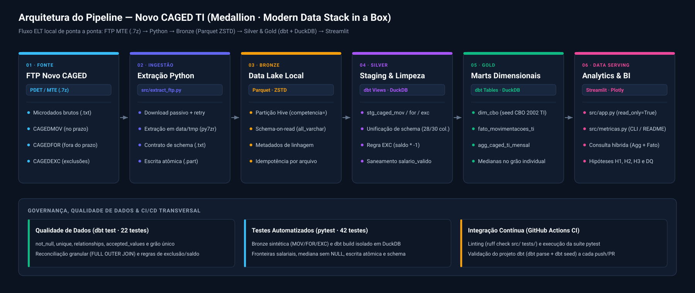

# Pipeline de Dados e Dinâmica do Emprego Formal de TI no Brasil (Novo CAGED)


## Resumo Executivo (TL;DR)

- **Problema:** o Novo CAGED publica microdados brutos, em `.7z`, com schemas divergentes entre arquivos e variáveis degradadas pós-eSocial, o que dificulta medir a dinâmica salarial e de entrada no emprego formal de TI.
- **Solução:** pipeline *Medallion* local (FTP → Parquet → dbt/DuckDB → Streamlit), com ingestão idempotente e atômica, regras contábeis de exclusão, saneamento de outliers e testes de grão, reconciliação e `pytest` com dados sintéticos.
- **Principal achado:** no nível Técnico, a mediana salarial de admissão é inferior à de desligamento nos três recortes (-3,8% a -7,1%), e a base Técnica concentra a absorção de jovens (≤ 24 anos: 42,7% das admissões no Ceará e 49,6% no Resto do Nordeste). Em Superior / Analista o Ceará fica estável (+0,1%), ao contrário do restante do país.


Pipeline de Engenharia de Dados (*Modern Data Stack in a Box*) para extração, tratamento, modelagem dimensional e análise das movimentações formais (CLT) em ocupações de Tecnologia da Informação no Brasil, com recorte comparativo para o **Ceará e Região Nordeste**, a partir dos microdados brutos do **Novo CAGED (MTE)**.

## Sumário

1. [Arquitetura (Medallion)](#arquitetura-medallion)
2. [Decisões de Engenharia e Tratamento de Dados](#decisões-de-engenharia-e-tratamento-de-dados-data-quality)
3. [Modelagem Dimensional e Testes de Qualidade (dbt)](#modelagem-dimensional-e-testes-de-qualidade-dbt)
4. [Limitações Conhecidas dos Dados](#limitações-conhecidas-dos-dados)
5. [Perguntas de Negócio e Hipóteses Testáveis](#perguntas-de-negócio-e-hipóteses-testáveis)
6. [Resultados e Conclusões Analíticas](#resultados-e-conclusões-analíticas-012025-a-082026)
7. [Estrutura do Repositório](#estrutura-do-repositório)
8. [Como Executar](#como-executar)
9. [Stack Tecnológica](#stack-tecnológica)

---

## Arquitetura (Medallion)

O pipeline foi desenhado para operar localmente com baixo consumo de disco e alta performance colunar, eliminando arquivos brutos intermediários após a conversão atômica para Parquet:



```text
FTP MTE (.7z) ──► data/tmp (.txt) ──► Bronze (Parquet ZSTD) ──► Silver (dbt views) ──► Gold (dbt tables) ──► Data Serving (Streamlit / src/app.py)
              └─── extract_ftp.py ───┘                      └─── stg_caged_* ───┘   └─── marts (dim/fct) ───┘
```

| Camada | Ferramenta | Armazenamento | Responsabilidade Técnica |
|---|---|---|---|
| **Ingestão & Bronze** | Python (`ftplib`, `py7zr`, `duckdb`) | `data/bronze/caged_<tipo>/competencia=<AAAAMM>/data.parquet` | Download idempotente em modo passivo, descompactação em diretório temporário (`data/tmp`), leitura *schema-on-read* (`all_varchar=True`, UTF-8), adição de metadados de linhagem e escrita atômica em Parquet (ZSTD). |
| **Silver (Staging)** | dbt + DuckDB | Schema `silver` (`data/caged.duckdb`) | Padronização de nomenclatura (snake_case sem acentos), unificação de schemas divergentes (MOV/FOR vs. EXC), tipagem explícita, tratamento de outliers salariais e inversão de sinal de exclusões. |
| **Gold (Marts)** | dbt + DuckDB | Schema `gold` (`data/caged.duckdb`) | Modelagem dimensional (Tabelas Fato e Dimensões), filtro de domínio via seed oficial da CBO 2002 e agregações (contagens, saldo e medianas salariais) no grão **Competência × Recorte Geográfico (Ceará / Resto do Nordeste / Resto do Brasil) × Nível de Carreira (Gestão / Superior-Analista / Técnico)**. |
| **Data Serving / BI** | Streamlit + Plotly | Leitura *read-only* (`data/caged.duckdb`) | Dashboard interativo ([`src/app.py`](src/app.py)) que consome as tabelas do schema `gold` em modo `read_only=True`, impedindo alterações no banco durante a visualização. |

---

## Decisões de Engenharia e Tratamento de Dados (Data Quality)

A inspeção exploratória dos microdados do Novo CAGED e da documentação técnica do PDET/MTE determinou as seguintes regras implementadas no pipeline:

### 1. Divergência de Schema (Schema Drift entre Arquivos)
Os arquivos `CAGEDMOV` (dentro do prazo) e `CAGEDFOR` (fora do prazo) possuem **28 colunas**, enquanto `CAGEDEXC` (exclusões) possui **30 colunas** (adicionando `competênciaexc` e `indicadordeexclusão`). A unificação na camada Silver utiliza padronização explícita de colunas para evitar quebra posicional.

- **Escrita Atômica, Resiliência e Linhagem na Bronze** ([`extract_ftp.py`](src/extract_ftp.py)):
  - **Escrita atômica:** o Parquet é gravado primeiro como `data.parquet.part` e só então renomeado atomicamente para `data.parquet`, evitando arquivos corrompidos caso o script seja interrompido no meio.
  - **Limpeza garantida de `.part`:** qualquer exceção durante a conversão remove o `data.parquet.part` parcial (`unlink(missing_ok=True)`) antes de ser relançada, de modo que nunca resta lixo no diretório e um `data.parquet` anterior é preservado.
  - **Validação explícita de contrato de schema:** antes de converter, `validar_colunas_txt` confere se o `.txt` contém as colunas exigidas pela Silver (`COLUNAS_OBRIGATORIAS_BASE` e, para EXC, `indicadordeexclusão` e `competênciaexc`). Se faltar alguma, a ingestão aborta com um `ValueError` que lista as colunas ausentes, em vez de falhar tarde, no `dbt`.
  - **Resiliência de rede:** até 3 tentativas por arquivo com *backoff* progressivo (5 s, 10 s) e reconexão automática ao FTP do MTE; modo binário garantido (`TYPE I`) e validação do tamanho baixado contra o `SIZE` do servidor.
  - **Linhagem:** injeção das colunas de auditoria `_competencia_arquivo`, `_tipo_arquivo`, `_arquivo_origem` e `_ingested_at` em cada registro.

### 2. Regra Contábil de Exclusões e Competência do Evento
- Conforme documentação oficial do Novo CAGED (`Leia-me.txt`), registros do arquivo EXC mantêm o sinal original do evento cancelado (`1` para admissão cancelada, `-1` para desligamento cancelado). Na camada Silver, o saldo efetivo é ajustado multiplicando `saldomovimentação` por `-1` quando `indicadordeexclusão = 1`.
- Todas as séries históricas são consolidadas pela **competência da movimentação** (`competênciamov`), e não pela competência da declaração (`competênciadec`), alocando declarações atrasadas (FOR) e exclusões (EXC) no mês em que o vínculo realmente ocorreu.
- **Isolamento de Eventos Ativos vs. Exclusões:** uma exclusão de desligamento gera saldo `+1`, mas **não é uma contratação nova**. Por isso, a fato expõe as flags `is_admissao_ativa` e `is_desligamento_ativo` (válidas apenas quando `indicador_exclusao = 0`), garantindo que cancelamentos afetem somente o saldo e não distorçam contagens nem o cálculo salarial de quem foi de fato admitido ou desligado.

### 3. Saneamento de Salários e Outliers do eSocial
- O campo `valorsaláriofixo` reflete a unidade de pagamento (`unidadesaláriocódigo`), trazendo valores por hora para horistas (ex.: R$ 10,49/h), enquanto a coluna `salário` traz o valor mensalizado.
- Devido a erros de preenchimento na origem (foram identificados registros de TI com `salário = 0` e valores de até R$ 1.382.700,00/mês), o pipeline **não descarta a linha** (preservando a contagem oficial de admissões/desligamentos), mas cria a métrica tratada `salario_valido`, anulando (`NULL`) valores abaixo de R$ 700,00 ou acima de R$ 100.000,00 para não distorcer médias e medianas na camada Gold.

### 4. Curadoria do Escopo de TI ([`seed_cbo_ti.csv`](dbt_caged/seeds/seed_cbo_ti.csv))
- O filtro de TI baseia-se nas famílias oficiais da CBO 2002: **1425** (Gerentes de TI), **2122** (Engenheiros em Computação), **2123** (Administradores de TI), **2124** (Analistas de TI), **3171** (Técnicos de Desenvolvimento) e **3172** (Técnicos de Operação/Suporte).
- **Expurgo de Falso Positivo:** o código `317115` ("Programador de máquinas - ferramenta com comando numérico"), embora pertença à família 3171, refere-se à operação de tornos CNC na indústria mecânica e foi removido da seed para não contaminar os indicadores de TI.

### 5. Ausência de Deduplicação Cega
Como os microdados não são identificados (sem CPF/CNPJ), múltiplas contratações idênticas na mesma empresa, cargo, município e faixa salarial geram linhas idênticas legítimas. O pipeline **não aplica `DISTINCT`** sobre os microdados.

### 6. Não-Aditividade da Mediana
A mediana **não é uma métrica aditiva**: calcular a média de medianas (ou reagregar medianas de UFs para regiões) gera distorção. Por isso, o mart [`agg_caged_ti_mensal`](dbt_caged/models/marts/agg_caged_ti_mensal.sql) calcula as medianas diretamente a partir do grão individual de `fato_movimentacoes_ti`, já no recorte final de consumo.

### 7. Janela de Análise e Retificações Anteriores
A janela analisada é definida pelos dados, e não por constante: vai da menor à maior `competencia_mov` presente nos arquivos **MOV** (declaração dentro do prazo). Os arquivos FOR (fora do prazo) e EXC (exclusões) também referenciam competências anteriores, mas só como retificações parciais, sem o MOV correspondente. Esses registros permanecem na Gold, preservando a linhagem, e ficam **fora** do dashboard e das métricas consolidadas. Misturá-los distorcia os indicadores: eram 689 registros FOR e 1.131 EXC anteriores a 01/2025.

---

## Modelagem Dimensional e Testes de Qualidade (dbt)

Objetos materializados no banco `data/caged.duckdb` e testes de qualidade executados via `dbt test` / `dbt build` (**21 testes de dados**, incluindo os testes singulares de grão, reconciliação e regras de exclusão, todos passando na camada Gold local):

| Objeto | Materialização | Descrição | Testes de Qualidade |
| :--- | :---: | :--- | :--- |
| `silver.stg_caged_mov` | View | Leitura dos Parquets da Bronze (MOV), tipagem e limpeza. | — |
| `silver.stg_caged_for` | View | Leitura dos Parquets da Bronze (FOR), tipagem e limpeza. | — |
| `silver.stg_caged_exc` | View | Leitura dos Parquets da Bronze (EXC), tipagem, limpeza e inversão de sinal. | — |
| `gold.dim_cbo` | Table | 25 ocupações de TI classificadas em 3 níveis de carreira (seed CBO 2002). | `unique` em `cbo_ocupacao`; `not_null` em `cbo_ocupacao`, `nome_ocupacao` e `familia_cbo` |
| `gold.fato_movimentacoes_ti` | Table | Movimentações consolidadas (MOV + FOR + EXC) no grão individual. | `not_null` em `cbo_ocupacao`, `competencia_mov`, `uf_codigo` e `saldo_ajustado`; `relationships` (`cbo_ocupacao` → `dim_cbo`); `accepted_values` `[-1, 1]` em `saldo_ajustado` |
| `gold.agg_caged_ti_mensal` | Table | Mart pré-agregado mensal (Competência × Recorte × Carreira) para consumo no Streamlit. | `not_null` nas chaves (`competencia_mov`, `recorte_geografico`, `nivel_carreira`) e nas métricas aditivas (`total_admissoes`, `total_desligamentos`, `saldo_liquido`, `admissoes_jovens_ate_24`); `accepted_values` em `recorte_geografico` |
| `assert_agg_unique_grain` | Teste singular | Garante uma única linha por (`competencia_mov`, `recorte_geografico`, `nivel_carreira`) no agregado. | Falha se retornar qualquer linha |
| `assert_reconciliacao_saldo_fato_vs_agg` | Teste singular | Reconcilia fato × agregado **por grupo** (`competencia_mov`, `recorte_geografico`, `nivel_carreira`) via `FULL OUTER JOIN` + `IS DISTINCT FROM` em saldo, admissões, desligamentos e jovens ≤ 24. | Falha em qualquer divergência, inclusive compensada entre grupos, ou grupo ausente |
| `assert_regras_exclusao_e_saldo` | Teste singular | Invariantes da regra contábil: exclusão nunca conta como admissão/desligamento ativo; `saldo_ajustado` só inverte o sinal em exclusões; todo registro não excluído é exatamente uma admissão ativa ou um desligamento ativo. | Falha se retornar qualquer linha |
| `tests/test_pipeline.py` | Suíte `pytest` | Gera Bronze sintética (MOV/FOR/EXC) e executa `dbt build` isolado. Valida inversão de sinal de exclusões (admissão e desligamento), fronteiras salariais (700,00 / 100.000,00 / 699,99), outlier, ausência de deduplicação, mediana ignorando `NULL`, classificação geográfica, ausência de colunas obsoletas e reconciliação granular (inclusive detecção de divergências). Verifica ainda a janela de análise, o volume por critério, a reconciliação do consolidado com a fato por grupo, medianas contra cálculo independente, fórmula do gap (`gap_percentual` com `None`/`NaN`/`inf`), contagens mensais da H1 (`gaps_mensais_h1`), distribuição de códigos da H2 (`tipos_movimentacao`), diferenciais regionais da H3 (`diferencial_regional_h3`) e renderização do Streamlit sob filtros estreitos sem `+nan%`. Em `extract_ftp.py`: escrita atômica sem resíduo `.part` (preservando destino preexistente), validação de schema, validação de competência, arquivo ausente no FTP e resiliência de retry/reconexão (conexão inicial e download). | 71 testes; executados no CI (`python -m pytest -q`) |

---

## Limitações Conhecidas dos Dados

- **Recorte apenas CLT:** o Novo CAGED capta exclusivamente vínculos celetistas formais; contratações via PJ, cooperativas, estágios ou trabalho informal não constam na base.
- **Fluxo de Contratações vs. Saturação:** os dados medem vínculos efetivados e encerrados, não o número de vagas abertas nem a quantidade de candidatos por vaga.
- **Snapshot dos microdados:** o Novo CAGED recebe declarações fora do prazo e retificações, então os números mudam quando os arquivos são baixados novamente. Os resultados abaixo se referem à extração local de outubro/2026; as competências mais recentes são as mais sujeitas a revisão.
- **Mediana sem deflator:** os gaps comparam medianas nominais de admitidos e desligados no mesmo período, sem correção por inflação, senioridade, porte da empresa ou composição dos cargos.
- **Qualidade de Variáveis Desagregadas:** conforme a Nota Técnica MTPS 088/12, variáveis como Subclasse CNAE, Ocupação (CBO) e Raça/Cor podem apresentar inconsistências em níveis muito desagregados, sendo mais robustas em análises agregadas.

---

## Perguntas de Negócio e Hipóteses Testáveis

Antes da análise na camada Gold, foram registradas as seguintes hipóteses com seus critérios objetivos de refutação:

**H1 — Substituição / Barateamento da Mão de Obra**
As empresas estão demitindo profissionais com salários mais altos e contratando substitutos com salários menores nas mesmas ocupações de TI.
- *Métrica:* razão entre a mediana do `salario_valido` dos admitidos vs. desligados por competência, recorte geográfico e nível de carreira.
- *Critério de refutação:* se a mediana salarial dos admitidos for igual ou superior à dos desligados (descontada a inflação/tendência) na maioria das competências.

**H2 — Porta de Entrada e Primeiro Emprego**
A absorção de profissionais iniciantes (≤ 24 anos) no mercado formal de TI concentra-se majoritariamente na base técnica, enquanto o indicador oficial de 1º emprego (`tipomovimentação = 10`) sofreu degradação estrutural pós-eSocial.
- *Métrica:* participação percentual (%) de admitidos com ≤ 24 anos no total de admissões de cada nível de carreira (Gestão, Superior/Analista, Técnico) e recorte geográfico; proporção de admissões com código `10` frente aos códigos `20` e `97`.
- *Critério de refutação:* se a participação de jovens no nível Técnico for igual ou inferior à dos níveis Superior/Analista e Gestão, ou se o código `10` apresentar volume compatível com a proporção de jovens admitidos.

**H3 — Dinâmica Regional e Diferencial Salarial (Ceará vs. Resto do Nordeste vs. Resto do Brasil)**
O mercado formal de TI no Ceará posiciona-se acima do **Resto do Nordeste** em remuneração de entrada e mantém saldo líquido positivo nos níveis operacionais e técnicos, mas preserva um *gap* salarial estrutural em relação ao **Resto do Brasil** (todas as UFs fora do Nordeste: Sudeste, Sul, Centro-Oeste e Norte; volume fortemente puxado pelo eixo Sul-Sudeste).
- *Métrica:* saldo líquido acumulado e mediana salarial de admissão em `UF = 23` (Ceará) comparados ao Resto do Nordeste e ao Resto do Brasil por nível de carreira, além do acompanhamento descritivo da série mensal do saldo.
- *Critério de refutação:* se a mediana salarial de admissão no Ceará for igual ou inferior à do Resto do Nordeste na maioria dos níveis de carreira, ou se convergir para o patamar do Resto do Brasil.
- *Escopo analítico:* a evolução mensal do saldo líquido é exibida no dashboard para inspeção visual; métricas formais de volatilidade/dispersão relativa do saldo entre recortes não foram modeladas nesta etapa.

---

## Resultados e Conclusões Analíticas (01/2025 a 08/2026)

> Os números desta seção (volume processado, consolidado por recorte e carreira, frequência mensal de gaps da H1, distribuição de códigos de movimentação da H2 e diferenciais salariais regionais da H3) são gerados diretamente da camada Gold por `python src/metricas.py` (`make metricas`), utilizando as mesmas definições do dashboard. Em caso de nova extração, regenere-os em vez de editar valores manualmente.

**Período analisado:** 01/2025 a 08/2026 (competência da movimentação)

### Volume de Dados Processados

| Grão / critério | Quantidade |
| :--- | ---: |
| Registros na fato (`fato_movimentacoes_ti`) | 802.514 |
| Admissões ativas (MOV + FOR) | 411.903 |
| Desligamentos ativos (MOV + FOR) | 390.112 |
| Registros de exclusão (EXC) | 499 |
| Saldo líquido (MOV + FOR − EXC) | +21.800 |
| Salários neutralizados (`salario_valido` nulo) | 4.385 |

> **Nomenclatura:** *registros na fato* é o grão individual de movimentação. Admissões ativas, desligamentos ativos e exclusões são critérios disjuntos que somam o total de registros; o saldo líquido não é uma contagem de registros. Por isso o volume de dados **não** equivale ao número de admissões.

### Consolidado por Recorte Geográfico e Nível de Carreira

| Recorte Geográfico | Nível de Carreira | Admissões | Desligamentos | Saldo Líquido | % Jovens (≤ 24 anos) | Mediana Salarial (Entrou) | Mediana Salarial (Saiu) | Gap Entrada vs. Saída |
| :--- | :--- | :---: | :---: | :---: | :---: | :---: | :---: | :---: |
| **Ceará** | Técnico | 4.904 | 4.352 | +551 | 42,7% | R$ 2.000,00 | R$ 2.094,19 | -4,5% |
| **Ceará** | Superior / Analista | 4.063 | 3.859 | +198 | 24,9% | R$ 4.120,46 | R$ 4.116,81 | +0,1% |
| **Ceará** | Gestão | 464 | 555 | -91 | 9,3% | R$ 8.000,00 | R$ 7.361,20 | +8,7% |
| **Resto do Nordeste** | Técnico | 14.610 | 11.966 | +2.647 | 49,6% | R$ 1.845,64 | R$ 1.918,00 | -3,8% |
| **Resto do Nordeste** | Superior / Analista | 13.355 | 12.375 | +990 | 27,3% | R$ 3.600,00 | R$ 3.995,60 | -9,9% |
| **Resto do Nordeste** | Gestão | 1.266 | 1.586 | -321 | 10,2% | R$ 6.491,70 | R$ 5.869,70 | +10,6% |
| **Resto do Brasil** | Técnico | 122.158 | 109.095 | +13.068 | 47,0% | R$ 2.414,47 | R$ 2.600,00 | -7,1% |
| **Resto do Brasil** | Superior / Analista | 228.615 | 216.521 | +12.077 | 24,5% | R$ 5.689,04 | R$ 5.873,98 | -3,1% |
| **Resto do Brasil** | Gestão | 22.468 | 29.803 | -7.319 | 5,2% | R$ 12.614,41 | R$ 13.000,00 | -3,0% |

> **Nota sobre o Saldo Líquido:** as colunas *Admissões* e *Desligamentos* contam apenas **eventos ativos** (MOV + FOR), enquanto o *Saldo Líquido* também desconta as **exclusões** (MOV + FOR − EXC). Por isso, em algumas linhas *Admissões − Desligamentos* difere do saldo (ex.: Ceará / Superior-Analista: 4.063 − 3.859 = 204, mas o saldo oficial é **+198**).

### Visualização Interativa (Data Serving)

O dashboard em Streamlit ([`src/app.py`](src/app.py)) consome diretamente o mart `gold.agg_caged_ti_mensal` e permite filtrar os indicadores acima por competência, recorte geográfico e nível de carreira, limitado à janela de análise (competências cobertas pelos arquivos MOV). As capturas abaixo vêm da mesma extração e do mesmo período (01/2025 a 08/2026).


**H1 · Barateamento da mão de obra**


**H2 · Porta de entrada**


**H3 · Dinâmica regional**


**Data Quality**


### Veredito das Hipóteses

1. **H1 (Substituição e Barateamento da Mão de Obra) — EVIDÊNCIA PARCIALMENTE CONSISTENTE COM A HIPÓTESE:**
   - **Técnico:** a mediana de admissão é inferior à de desligamento nos três recortes (**Ceará -4,5%**, **Resto do Nordeste -3,8%**, **Resto do Brasil -7,1%**), com gap negativo na maioria das 20 competências válidas da janela (12 de 20, 17 de 20 e 19 de 20, respectivamente).
   - **Superior / Analista:** o deságio aparece no **Resto do Nordeste (-9,9%**, de R$ 3.995,60 nos desligados para R$ 3.600,00 nos admitidos) e no **Resto do Brasil (-3,1%)**. No **Ceará** as medianas são praticamente iguais (**+0,1%**: R$ 4.120,46 vs. R$ 4.116,81), e esse grupo **não** sustenta a hipótese de barateamento.
   - **Gestão (`CBO 1425`) — indicador observado:** o saldo líquido é negativo em todos os recortes (**-7.319 no Resto do Brasil**, **-321 no Resto do Nordeste** e **-91 no Ceará**), e a mediana de admissão supera a de desligamento no Ceará (**+8,7%**) e no Resto do Nordeste (**+10,6%**), enquanto no Resto do Brasil ela é inferior (**-3,0%**).
   - **Gestão — hipótese explicativa (não demonstrada diretamente):** uma possibilidade plausível é o enxugamento de cargos intermediários com contratações pontuais em faixas superiores. Os microdados não trazem senioridade individual, então essa leitura exige controle adicional para ser confirmada e não deve ser tratada como fato.
   - **Critério de refutação (contagem mensal reproduzida por `metricas.gaps_mensais_h1`):** calculando as medianas de admissão e desligamento por competência diretamente no grão individual (denominador = `competencias_validas`, isto é, competências com par válido de medianas; meses sem par válido ficam como `Indefinido` e não entram como negativos), o gap é negativo na maioria das competências em **7 dos 9 grupos** — Técnico (12 de 20 no Ceará, 17 de 20 no Resto do Nordeste e 19 de 20 no Resto do Brasil), Superior / Analista (11 de 20 no Ceará, 16 de 20 no Resto do Nordeste e 14 de 20 no Resto do Brasil) e Gestão no Resto do Brasil (12 de 20 negativas, 2 de 20 com gap zero e 6 de 20 positivas). As exceções são Gestão no Ceará (9 de 20) e Gestão no Resto do Nordeste (7 de 20).
   - **Nota metodológica:** os microdados mostram um deságio salarial líquido entre o fluxo de entrada e o de saída nos mesmos grupos ocupacionais. Por serem dados anonimizados, sem identificador de empresa ou indivíduo, eles não medem substituição direta 1-para-1 no mesmo CNPJ, e a associação não é causal sem controle de variáveis adicionais (porte da empresa, senioridade, inflação e composição dos cargos).

2. **H2 (Porta de Entrada e Primeiro Emprego) — EVIDÊNCIA CONSISTENTE COM A HIPÓTESE (+ ACHADO TÉCNICO DE DATA QUALITY):**
   - **Degradação da variável de primeiro emprego:** nas admissões ativas do período, **99,95%** estão no código `97 - Admissão de tipo ignorado` e **0,05%** no código `35 - Reintegração`. Os códigos `10 - Primeiro emprego` e `20 - Reemprego` não aparecem. A variável, portanto, não discrimina o tipo de admissão neste recorte, e isso indica falta de preenchimento na origem. Não se deve inferir ausência de primeiros empregos.
   - Utilizando a **faixa etária (≤ 24 anos)** como proxy de entrada no mercado formal, a base **Técnica** concentra a absorção de jovens (**42,7%** das admissões no Ceará, **49,6%** no Resto do Nordeste e **47,0%** no Resto do Brasil), contra 24,5% a 27,3% em Superior / Analista e 5,2% a 10,2% em Gestão. Ressalva: a idade é uma aproximação, pois um jovem de 24 anos pode ser reemprego.

3. **H3 (Dinâmica Regional: Ceará vs. Resto do Nordeste vs. Resto do Brasil) — EVIDÊNCIA PARCIALMENTE AVALIADA (CONSISTENTE NA DIMENSÃO SALARIAL E DE SALDO ACUMULADO):**
   - **Diferencial intra-regional (Ceará vs. Resto do Nordeste):** a mediana de admissão do **Ceará** supera a do Resto do Nordeste em todos os níveis de carreira — **+8,4%** em Técnico (R$ 2.000,00 vs. R$ 1.845,64), **+14,5%** em Superior / Analista (R$ 4.120,46 vs. R$ 3.600,00) e **+23,2%** em Gestão (R$ 8.000,00 vs. R$ 6.491,70) — com saldo acumulado positivo na base técnica (**+551**) e analítica (**+198**) e retração em Gestão (**-91**).
   - **Gap frente ao Resto do Brasil:** o grupo **Resto do Brasil** compreende todas as demais UFs fora do Nordeste (Regiões Sudeste, Sul, Centro-Oeste e Norte), com volume fortemente puxado pelo eixo Sul-Sudeste. Em relação a esse recorte, o Ceará apresenta mediana de admissão **-17,2%** menor em Técnico (R$ 2.000,00 vs. R$ 2.414,47), **-27,6%** em Superior / Analista (R$ 4.120,46 vs. R$ 5.689,04) e **-36,6%** em Gestão (R$ 8.000,00 vs. R$ 12.614,41).
   - **Limitação de escopo (volatilidade não quantificada):** embora a série mensal do saldo líquido esteja disponível no painel para inspeção visual, a volatilidade do saldo relativo entre os recortes **não foi avaliada quantitativamente** (por exemplo, via desvio-padrão padronizado ou coeficiente de variação). Assim, os dados corroboram o posicionamento salarial intermediário do Ceará (acima do Resto do Nordeste e abaixo do Resto do Brasil), sem conclusão estatística sobre estabilidade ou volatilidade temporal do saldo.

---

## Estrutura do Repositório

```text
caged_ti_pipeline/
├── .github/workflows/
│   └── ci.yml                         # CI (lint + pytest + validação dbt)
├── data/                              # Dados locais ignorados no Git (bronze/, tmp/, caged.duckdb)
├── dbt_caged/                         # Projeto dbt
│   ├── macros/
│   │   ├── generate_schema_name.sql   # Schemas limpos (silver / gold) sem prefixo do target
│   │   └── stg_caged_base.sql         # Lógica de staging compartilhada entre MOV / FOR / EXC
│   ├── models/
│   │   ├── staging/                   # stg_caged_mov, stg_caged_for, stg_caged_exc, _sources.yml
│   │   └── marts/
│   │       ├── dim_cbo.sql
│   │       ├── fato_movimentacoes_ti.sql
│   │       ├── agg_caged_ti_mensal.sql
│   │       └── _marts.yml             # Documentação e testes da Gold
│   └── seeds/
│       └── seed_cbo_ti.csv            # Escopo oficial de ocupações de TI (CBO 2002)
├── docs/                              # Diagrama de arquitetura (SVG/PNG) e capturas do dashboard
├── src/
│   ├── extract_ftp.py                 # CLI de ingestão FTP → Bronze (Parquet)
│   ├── metricas.py                    # Métricas consolidadas direto da Gold (fonte do README)
│   └── app.py                         # Dashboard Streamlit
├── tests/
│   └── test_pipeline.py               # Testes com dados sintéticos (pytest)
├── Makefile                           # Atalhos de execução
└── requirements.txt                   # Dependências do ambiente Python
```

---

## Como Executar

### 1. Ambiente

```powershell
# Criar e ativar o ambiente virtual (Windows PowerShell)
python -m venv .venv
.\.venv\Scripts\Activate.ps1
pip install -r requirements.txt
```

### 2. Ingestão Bronze (CLI `src/extract_ftp.py`)

```powershell
# Uma competência
python src/extract_ftp.py --competencia 202501

# Múltiplas competências
python src/extract_ftp.py --competencia 202501 202502

# Ano inteiro (backfill)
python src/extract_ftp.py --ano 2025

# Apenas um tipo de arquivo (teste rápido)
python src/extract_ftp.py --competencia 202601 --tipos EXC

# Forçar reprocessamento, ignorando a trava de idempotência
python src/extract_ftp.py --competencia 202601 --force
```

### 3. Transformação e Testes (dbt)

```powershell
# Executar a partir da pasta dbt_caged (onde está o dbt_project.yml)
cd dbt_caged

# Execução completa: seeds + modelos Silver/Gold + testes
python -m dbt.cli.main build --profiles-dir .

# Documentação e grafo de linhagem
python -m dbt.cli.main docs generate --profiles-dir .
python -m dbt.cli.main docs serve --profiles-dir .
```

### 4. Dashboard (Streamlit)

```powershell
# Na raiz do repositório
cd ..
python -m streamlit run src/app.py
```

### Atalhos via Makefile

```powershell
make setup                # instala dependências
make extract COMP=202601  # ingestão Bronze de uma competência
make build                # dbt seed + run + test
make pytest               # testes automatizados com dados sintéticos
make metricas             # métricas consolidadas da Gold, para conferir o README
make docs                 # gera e serve a documentação do dbt
make pipeline COMP=202601 # extract + build
```

> [!WARNING]
> **Nota sobre Concorrência no DuckDB:** o dashboard ([`src/app.py`](src/app.py)) utiliza conexões DuckDB em modo `read_only=True`, impedindo alterações no banco durante a visualização. Entretanto, como o DuckDB utiliza um arquivo local único (`data/caged.duckdb`), processos distintos de leitura e escrita (como o Streamlit, o `dbt build` ou clientes SQL externos como DBeaver) podem apresentar conflitos de acesso (*lock*) se acessarem o arquivo simultaneamente. Recomenda-se executar as transformações `dbt` separadamente das consultas ao dashboard.

---

## Stack Tecnológica

Python · DuckDB · dbt-duckdb · Apache Parquet (ZSTD) · Streamlit · GitHub Actions
